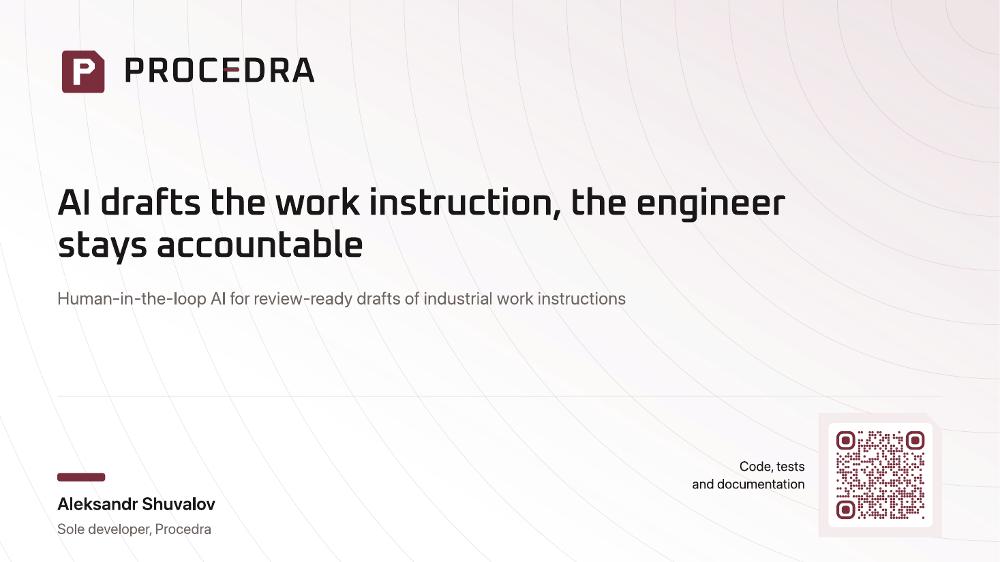
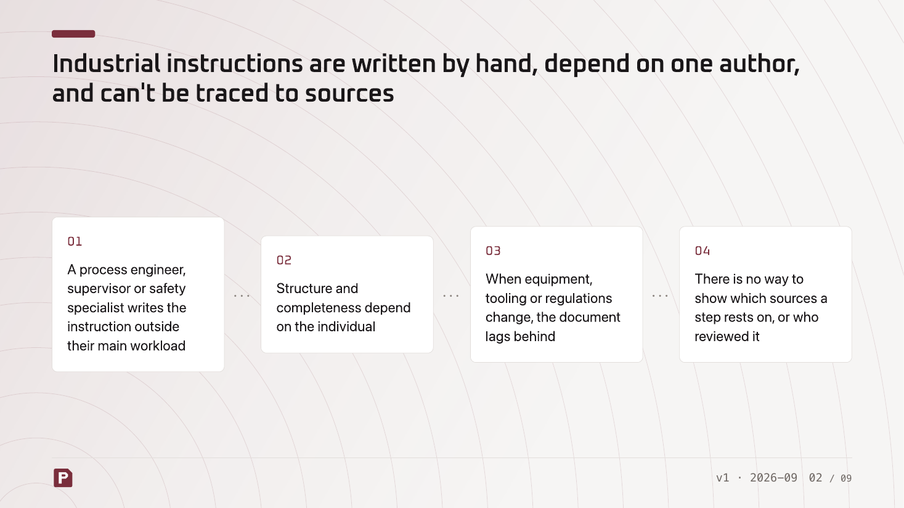
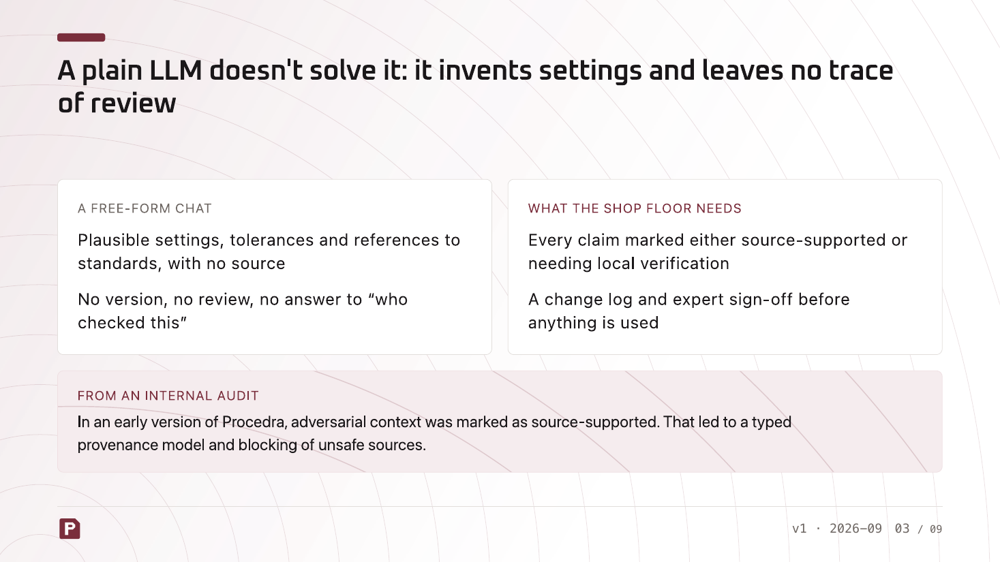
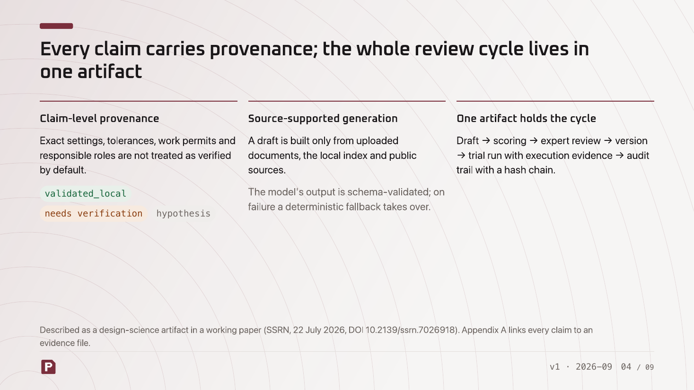
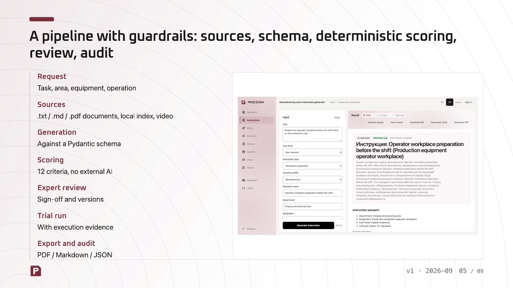
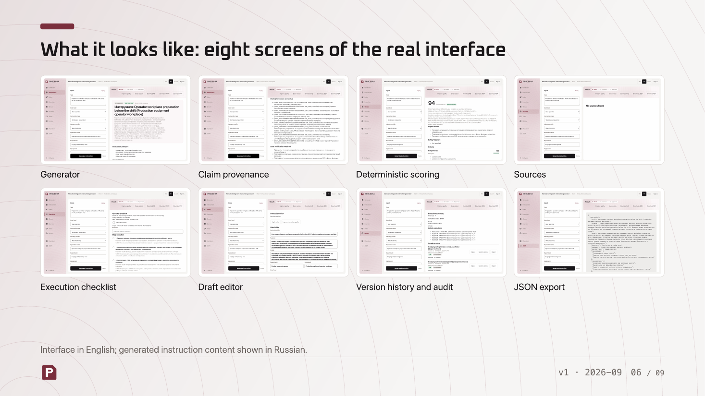
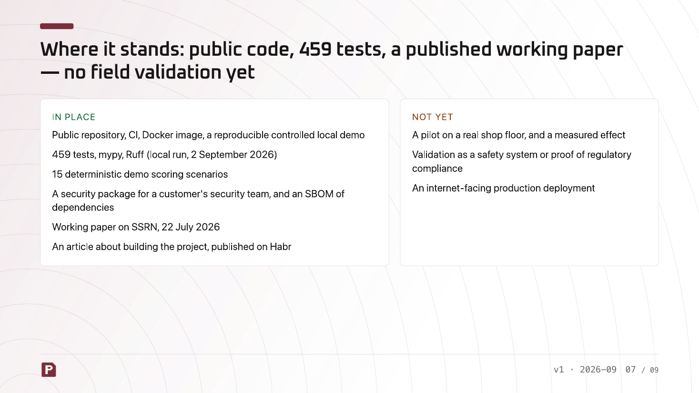
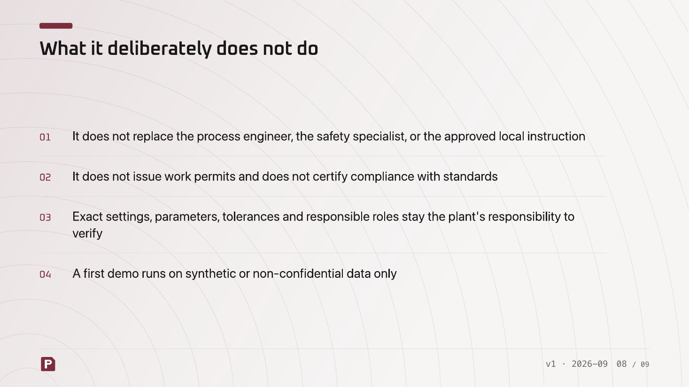
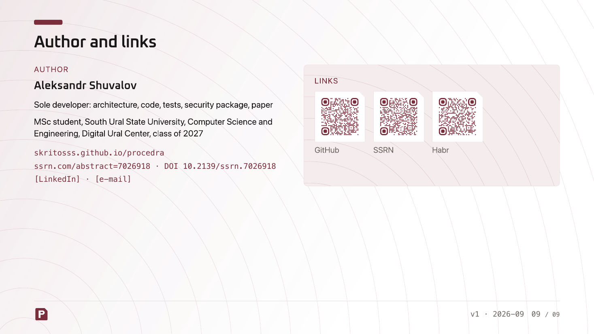

### Hi, I'm Alex.

**AI Product Engineer** — I take systems from architecture to a working product: retrieval, computer vision, role-based workflows, tests, CI.

I came from the product and funding side: 6M RUB (~$70K) in non-dilutive funding across 5 projects, listed author on registered MedAI software. That is why I build with provenance, review workflows, and audit trails.

[Portfolio](https://skritosss.github.io) · [Email](mailto:shuv.aleksandr@icloud.com) · [LinkedIn](https://www.linkedin.com/in/alex-shuvalov-4885a9387/) · [Repositories](https://github.com/skritosss?tab=repositories)

**[10 merged pull requests across 7 open-source repositories](https://github.com/pulls?q=is%3Apr+author%3Askritosss+is%3Amerged)** · [3 open pull requests](https://github.com/pulls?q=is%3Apr+author%3Askritosss+is%3Aopen) · verified November 5, 2026.

### Open Source Contributions

| Project | Accepted contributions |
| --- | --- |
| **Mellea** | Hardened release-dispatch version validation and literal payload handling: [#1731](https://github.com/generative-computing/mellea/pull/1731) |
| **Autosubmit** | Documented YAML folder loading, ordering, and configuration overrides: [#3354](https://github.com/BSC-ES/autosubmit/pull/3354) |
| **Backlot** | GitHub API pagination and version-header handling; HubSpot object-type IDs: [#686](https://github.com/brekkylab/backlot/pull/686), [#817](https://github.com/brekkylab/backlot/pull/817), [#848](https://github.com/brekkylab/backlot/pull/848) |
| **Agent Swarm** | Consistent parsing of provider and integration environment flags: [#2096](https://github.com/desplega-ai/agent-swarm/pull/2096), [#2097](https://github.com/desplega-ai/agent-swarm/pull/2097) |
| **Ansible ClickHouse** | Corrected community communication links: [#255](https://github.com/ansible-collections/community.clickhouse/pull/255) |
| **BeeWare** | Dependabot update cooldowns in two repositories: [Python-support-testbed #194](https://github.com/beeware/Python-support-testbed/pull/194), [cpython-apple-source-deps #95](https://github.com/beeware/cpython-apple-source-deps/pull/95) |

---

<b>Procedra deck — 9 slides</b> (click to expand · <a href="assets/procedra-deck/procedra-deck-en.pdf">download PDF</a>)

 

---

### Currently building: [Procedra](https://github.com/skritosss/procedra-showcase)

An AI system that turns operator requests, enterprise documents, public standards, and video context into review-ready industrial work-instruction drafts — under mandatory expert approval. Sole developer.

- FastAPI/Pydantic application end to end, from generation schemas and validation to JSON, Markdown, and PDF export.
- Hybrid semantic/keyword retrieval with source-influence scoring, and durable video processing with keyframe extraction and frame-level vision analysis.
- Deterministic fallback that keeps the product fully usable without an external LLM.
- Enterprise layer: 6 roles, organizations, projects, permission matrix, instruction versioning, review workflow, execution checklists, audit trail.
- Security audit of my own system: found that adversarial context could be labelled as confirmed and score high. Introduced typed provenance, blocked model-supplied approval state, added explicit blockers for hazardous and poisoned-source cases.
- Quality gate: 406 passing tests, clean mypy across 46 files, Ruff, Docker Compose, CI, and a 15-scenario pack for reproducible evaluation.

Working paper on SSRN, Abstract ID `7026918`.

### Skills

| Area | What I work with |
| --- | --- |
| **Engineering** | Python, FastAPI, Pydantic, SQL, JavaScript / TypeScript, Docker, GitHub Actions, pytest, mypy, Ruff, SQLite, REST APIs |
| **AI & data** | RAG and hybrid retrieval, LLM integration, structured output with schema validation, deterministic fallback, generation quality evaluation, video computer vision |
| **Product** | Discovery, PRDs, MVP scoping, market research, competitor mapping, unit economics, grant applications · Figma, FlutterFlow |

### Selected Impact

- Took an AI decision-support tool for pediatric immunosuppressive therapy from concept to **registered software** in 18 months; listed as an author on the state registration certificate (MedAI).
- Secured **6M RUB (~$70K) in non-dilutive funding** across 5 early-stage digital products in medtech, edtech, tourism, social impact, and consumer technology.
- Owned research and grant work at an early-stage product studio: market research, competitor mapping, and market sizing that teams used to decide what to launch and what to cut from MVP scope.

### Public Work

| Repository | What it shows |
| --- | --- |
| [procedra-showcase](https://github.com/skritosss/procedra-showcase) | AI system for review-ready industrial work instructions: retrieval, video analysis, roles, versioning, audit trail |
| [medai-case-study](https://github.com/skritosss/medai-case-study) | public AI product case study: architecture, process, privacy-aware product thinking, lessons learned |
| [engineering-drawing-ocr](https://github.com/skritosss/engineering-drawing-ocr) | limited-code OCR case study for technical drawings, preprocessing, and custom recognizer experiments |
| [portfolio](https://github.com/skritosss/skritosss.github.io) | project portfolio, selected work, and professional overview |

### Education

- **MSc, Computer Science and Engineering** — South Ural State University, "Digital Ural" elite IT program · Sep 2025 – Present
- **BSc, Architecture and Civil Engineering** — South Ural State University · 2021 – 2025
- Finalist, "Startup as a Thesis" (SUSU) 2025 · Semi-finalist, MSU Startup Accelerator 2022 · JPMorganChase job simulations on Forage 2026
- Russian native · English C1

### Toolbox

  
  
  
  
  
  
  
  
  
  
  
  
  
  
  

### GitHub

  
  

